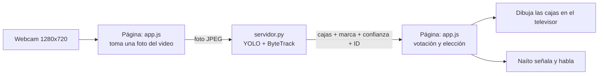

# ¿Cómo funciona el Bar Naíto? 🍺🤖

Explicación sencilla de cómo está hecha la demo, para el grupo. Primero va la idea con ejemplos de nuestras latas y
después dónde está cada cosa en el código.

---

## 1. La idea en una frase

La webcam graba, **YOLO** encuentra las latas en cada imagen, **ByteTrack** le pone un número (ID) a cada lata para
seguirla entre imágenes, y **Naíto** señala la lata que más le gusta según su lista de gustos.

## 2. Las dos piezas: el mesero y la cocina

La demo tiene dos programas que hablan entre sí:

| Pieza | Archivo | Qué hace | Analogía |
|---|---|---|---|
| **Página web** | `web/index.html`, `web/app.js`, `web/estilos.css` | Abre la cámara, dibuja el bar, el robot y las cajas, y decide qué cerveza señalar | El **mesero**: atiende, toma el pedido y lo sirve bonito |
| **Servidor** | `servidor.py` | Recibe cada imagen, corre YOLO + ByteTrack y devuelve las cajas | La **cocina**: hace el trabajo pesado |

¿Por qué dos piezas? Nuestros modelos son archivos `.pt` de **PyTorch**, que corren en Python con Ultralytics, igual
que en los notebooks. Un navegador no puede correr eso directamente. Lo más sencillo fue:
- dejar **YOLO en Python** (`servidor.py`, con el mismo `ultralytics` de los notebooks);
- dejar **lo visual en el navegador**, donde es fácil hacer animaciones.

`iniciar.bat` arranca el servidor y abre la página. Todo pasa **dentro del mismo computador** (`localhost`): no se
manda nada a internet.



## 3. Lo que pasa con cada imagen (paso a paso)

Esto se repite todo el tiempo, una imagen a la vez:

1. **La página toma una foto del video** de la webcam (1280×720) y la comprime como **JPEG**, que es más liviano para
   enviarla.
2. **Se la manda al servidor** (`/api/detectar`), junto con el umbral de confianza del panel.
3. **El servidor la convierte en imagen** con OpenCV (`cv2.imdecode`), igual que los frames de `probar_modelo.py`.
4. **Corre YOLO con tracking:**

   ```python
   r = model.track(frame, persist=True, tracker="bytetrack.yaml", conf=conf, imgsz=640)
   ```

   YOLO reescala la imagen a 640, igual que en el entrenamiento, y encuentra las latas.
5. **Responde con una lista de cajas**, por ejemplo:

   ```json
   { "clase": "aguila", "conf": 0.87, "caja": [0.41, 0.30, 0.52, 0.71], "id": 3 }
   ```

   La caja va en **coordenadas normalizadas** (de 0 a 1): `0.41` significa "al 41 % del ancho". Así no importa el
   tamaño de la pantalla.
6. **La página decide qué hacer**: actualiza las latas que conoce, vota la marca, escoge la favorita y mueve al robot.
7. **Apenas llega la respuesta, se manda la siguiente foto.**

El video del televisor siempre va a 30 fps, porque es la webcam directa. Las **detecciones** van más lento: depende
de cuántos ms tarde el modelo, y eso es lo que muestra el HUD del televisor (FPS y ms de inferencia).

## 4. El detector (YOLO): ve fotos sueltas

Nuestro `.pt` es un **detector**: mira **cada imagen por separado** y dice "aquí hay una Águila con 87 %". No
tiene memoria: no sabe que la Águila de esta imagen es la misma de la imagen anterior.

Eso causa dos problemas en una demo en vivo:
- **Parpadeo:** en una imagen la lata sale como Andina, en la siguiente como Póker y luego otra vez como Andina. Si
  el robot le hiciera caso a cada imagen, cambiaría de opinión a cada rato.
- **No hay identidad:** si hay dos Águilas en la mesa, no sabemos cuál es cuál.

Para eso está el **tracking**.

## 5. El tracking: dos niveles

### Nivel 1: ByteTrack (en el servidor) pone los IDs

**ByteTrack no es una red neuronal y no se entrena.** Es un algoritmo que ya viene en Ultralytics y se usa
**después** de entrenar, al momento de usar el modelo. Por eso no tuvimos que reentrenar nada: solo cambiamos
`model.predict(...)` por `model.track(...)`.

**Analogía:** YOLO es un fotógrafo que toma muchas fotos por segundo y en cada una marca las latas. ByteTrack es quien
pone las fotos en orden y dice: "esta lata es la misma que venía por aquí, sigue siendo la #3".

Lo que hace con cada imagen nueva:

1. **Predice dónde debería estar cada lata conocida.** Usa un *filtro de Kalman*: "si la lata #3 venía moviéndose a
   la derecha, ahora debería estar un poco más a la derecha".
2. **Empareja las cajas nuevas con esas predicciones** según cuánto se solapan. Es el mismo **IoU** de las métricas:
   si una caja nueva se solapa mucho con donde se esperaba la #3, es la #3. El mejor emparejamiento lo calcula la
   librería **`lap`** (por eso está en `requirements.txt`).
3. **El truco de ByteTrack son las dos rondas:**
   - **primera ronda:** empareja las cajas de confianza **alta** (≥ 0.25);
   - **segunda ronda:** intenta emparejar las de confianza **baja** (entre 0.1 y 0.25) con las latas que se quedaron
     sin pareja.

   La idea es que, si una lata queda medio tapada por la mano y el modelo baja a 15 %, no pierda su ID.
4. **Las cajas sin pareja** y con confianza suficiente se vuelven una **lata nueva** con un ID nuevo.
5. **Las latas que desaparecen** se recuerdan unos **30 frames** (`track_buffer`). Si vuelven en ese tiempo,
   recuperan su mismo ID.

Esos números están en el archivo `bytetrack.yaml` de Ultralytics: `track_high_thresh: 0.25`,
`track_low_thresh: 0.1`, `new_track_thresh: 0.25`, `track_buffer: 30` y `match_thresh: 0.8`.

`persist=True` le dice al tracker que **recuerde** las latas de la imagen anterior. Sin eso, cada imagen empezaría de
cero y los IDs no servirían.

> **Detalle importante (revisado en el código de Ultralytics):** `model.track` usa por defecto `conf=0.1`,
> precisamente para que ByteTrack reciba las cajas de baja confianza. Nosotros le pasamos el umbral del panel
> (0.50 por defecto), así que las cajas de menos de 0.50 se descartan **antes** de llegar al tracker, y la segunda
> ronda casi no tiene con qué trabajar. Si en la prueba con webcam el robot pierde la lata al taparla con la mano,
> se puede mejorar así: darle al tracker `conf=0.1` y aplicar el umbral del panel solo para decidir qué se muestra.

### Nivel 2: nuestra lógica (en `app.js`) decide qué hacer con los IDs

Con los IDs, la página guarda una **"pista"** por cada lata, con su historia. Encima de eso hicimos cuatro reglas:

1. **Confirmar antes de creer.** Una lata nueva solo cuenta cuando se ha visto en **2 frames** (`CONFIRMA = 2`). Una
   detección suelta de un solo frame no hace que el robot cambie de opinión.
2. **Votación de marca.** Cada vez que se ve una lata, su marca recibe un "voto" que vale lo que valga su confianza.
   La marca de la lata es la que tenga más votos acumulados. Ejemplo:

   | Frame | El detector dice | Votos acumulados de la lata #3 | Marca que usamos |
   |---|---|---|---|
   | 1 | aguila 0.85 | aguila 0.85 | Águila |
   | 2 | aguila 0.88 | aguila 1.73 | Águila |
   | 3 | **poker 0.52** (parpadeo) | aguila 1.73 · poker 0.52 | **Águila** ✓ |
   | 4 | aguila 0.86 | aguila 2.59 · poker 0.52 | Águila |

   Sin votación, en el frame 3 el robot habría dicho "¡Uff, solo hay Póker!".
3. **Memoria corta.** Si una lata deja de verse, sigue contando **500 ms** (`OLVIDO_MS`). La lata que Naíto está
   señalando aguanta más: **1.2 s** (`OLVIDO_ELEGIDA_MS`), para que no se distraiga si parpadea.
4. **Fidelidad a su lata.** Naíto se queda con **su lata (su ID)** mientras siga en cámara, y solo cambia si aparece
   una que le guste **más**. Además, **solo habla cuando cambia la marca** elegida, no en cada frame. Si la misma
   marca vuelve en menos de **8 s** (`REPETIR_MS`), cambia el texto sin repetirlo en voz alta.

**Sin tracking** (se puede apagar en el panel) todo funciona igual, pero las pistas se agrupan **por marca** en vez de
por ID. Funciona, pero se pierde la identidad: dos Águilas cuentan como una sola.

## 6. Cómo escoge Naíto

- **La lista de gustos** es un arreglo ordenado: posición 0 = le encanta, posición 5 = nada. Se reordena arrastrando
  las cajitas en el panel o en la pizarra, y se guarda en el navegador.
- **De las latas confirmadas**, escoge la que esté **más arriba en la lista**. Si hay empate (dos latas de la misma
  marca), escoge la de más confianza.
- **Su humor depende de la posición** de la elegida:

| Posición en la lista | Ojos / LEDs | Qué hace |
|---|---|---|
| 1 | corazones | saluda con el otro brazo y salta |
| 2 y 3 | verdes | contento |
| 4 y 5 | amarillos | "meh" |
| 6 | azules | triste, ojos caídos |
| ninguna lata | cian | mira a los lados buscando |

## 7. Cómo se mueve el robot

- **Naíto es un dibujo SVG** (círculos y rectángulos). Cada parte (cabeza, brazos, ojos, boca) tiene un `id`, y
  `app.js` le cambia la rotación unas 60 veces por segundo.
- **Para señalar la lata**, se calcula el ángulo desde el **hombro** del robot hasta el **centro de la caja**:

  ```js
  ángulo = Math.atan2(lata.y - hombro.y, lata.x - hombro.x)
  ```

  `atan2` da el ángulo de la línea que une dos puntos: es la trigonometría de "hacia dónde apuntar".
- **El movimiento es suave** porque el brazo no salta al ángulo nuevo: en cada cuadro avanza un 15 % de lo que le
  falta (`suave(a, b, 0.15)`, una interpolación lineal). Por eso se mueve como un robot y no tiembla.
- **La línea punteada** del dedo a la lata se dibuja en un `<canvas>` encima de todo.
- **Coordenadas:** la caja llega normalizada (0 a 1). Se pasa a píxeles del televisor y luego a píxeles del
  escenario, para saber dónde está la lata en el dibujo del bar.
- **Espejo:** solo voltea lo que se ve. Al modelo le llega la imagen sin voltear, porque entrenamos con `fliplr=0` (los
  logos no se voltean).

## 8. La entrada del saloon

- **La fachada es un SVG con un "hueco" en la puerta** (una *máscara*): todo se pinta menos ese rectángulo. Por el
  hueco se ve el bar **de verdad**, en miniatura (60 % de su tamaño), con Naíto saludando.
- **Las puertas vaqueras** son dos imágenes que giran en 3D con CSS (`rotateY`), cada una alrededor de su bisagra.
- **Al presionar "Entrar":** las puertas giran y rebotan, la fachada crece y se desvanece, y a la vez el bar crece de
  60 % a 100 %. Las dos animaciones juntas dan la sensación de "entrar".
- **El botón también arranca la cámara y el modelo.** Los navegadores solo dejan usar cámara y sonido después de un
  clic del usuario, así que el botón cumple las dos funciones.
- **Mientras se está en la puerta**, el servidor ya va cargando el modelo en segundo plano, para que al entrar esté
  listo.

## 9. Seguridad (por qué el servidor es "desconfiado")

El servidor solo escucha en `localhost`, o sea, en el mismo computador. Además, solo acepta peticiones **de la propia
página del Bar Naíto**:
- revisa los encabezados `Host` y `Origin`;
- exige el tipo de contenido correcto (JSON o JPEG);
- rechaza envíos de más de 5 MB.

Así, otra página web abierta en el navegador no puede usar el servidor a escondidas. Y para cargar modelos solo se
aceptan nombres de la carpeta `modelos/`, no rutas cualquiera.

## 10. Dónde está cada cosa

| Qué | Dónde |
|---|---|
| Cargar el `.pt`, YOLO + ByteTrack | `servidor.py` → `cargar_modelo()`, `detectar()` |
| Seguridad del servidor | `servidor.py` → `es_de_la_demo()`, `do_POST()` |
| Tomar la foto de la webcam y enviarla | `web/app.js` → `bucleDeteccion()` |
| Pistas, votación y elección de la favorita | `web/app.js` → `procesar()` |
| Frases y voz | `web/app.js` → `FRASES`, `hablar()` |
| Movimiento del robot y línea punteada | `web/app.js` → `animar()` |
| Gustos arrastrables | `web/app.js` → `pintarGustos()`, `hacerArrastrable()` |
| Entrada del saloon | `web/index.html` (`#entrada`), `web/app.js` → `entrar()`, `escalar()` |
| Dibujo del bar y del robot | `web/index.html` (SVG) y `web/estilos.css` |

## 11. Limitaciones (para decirlo en la presentación si preguntan)

- **El tracking no arregla un modelo que se equivoca siempre.** Si el modelo confunde *de forma constante* una
  Andina con una Póker, el tracker solo sigue con constancia a una lata mal identificada. Eso se arregla con más y
  mejores datos de entrenamiento. La votación solo ayuda con los errores **sueltos**.
- **Si dos latas se cruzan muy cerca**, ByteTrack puede intercambiar sus IDs (*ID switch*).
- **El dataset es pequeño**, así que las métricas cambian mucho con pocos errores. Hay que mostrarlo como una demo, no
  como un sistema terminado.
- **Mandar cada imagen como JPEG** del navegador al servidor agrega un poco de tiempo. Por eso los FPS de detección
  pueden ser algo menores que con `probar_modelo.py`.
